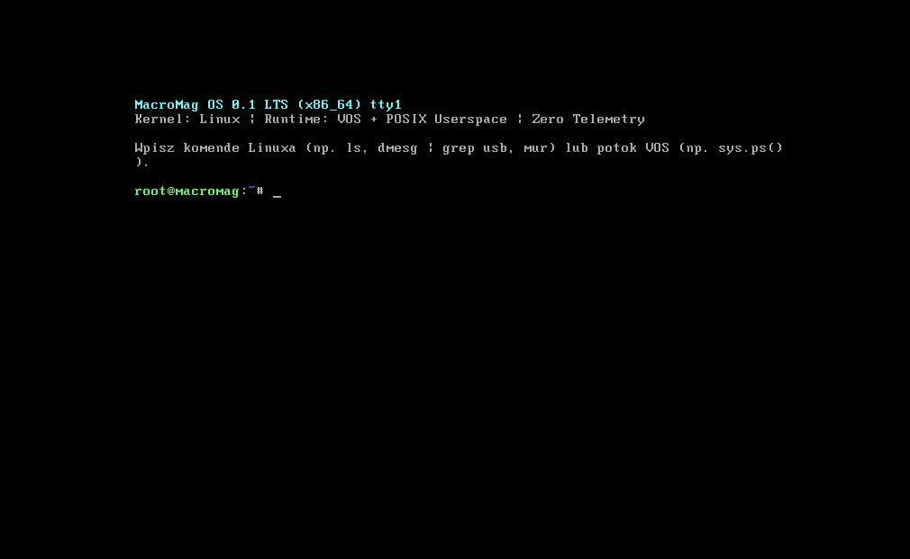

 # MacroMag OS: Modular Linux Distribution New Architecture by Adrian Morawski

<p align="center">
  
</p>


 [](https://doi.org/10.5281/zenodo.24201693)

[](https://www.bestpractices.dev/projects/16688)

[](https://www.gnu.org/licenses/gpl-3.0)
[](#)
[](#)
[](#)
[](https://github.com/MacroMag-os/MacroMag-32/actions/workflows/release.yml)
[](https://github.com/MacroMag-os/MacroMag-32/stargazers)
[](https://github.com/MacroMag-os/MacroMag-32/network/members)
[](https://github.com/MacroMag-os/MacroMag-32/issues)
[](https://github.com/MacroMag-os/MacroMag-32/commits/main)
[](https://opencollective.com/macromag)


> *"Those who are crazy enough to think they can change the world, are the ones who do."* — Steve Jobs

Modern computing is trapped in a cycle of planned obsolescence. Mainstream operating systems and locked-down hardware (*eFUSEs*, remote kill-switches, mandatory cloud telemetry) actively turn perfectly functional electronics into e-waste.

## 📜 Rules of Repository
**1. If you creating a Issues, include this:**
- Create a note and explain note (If your issue need instructions) 
`Example: " I Want to tell about¹ this. " ¹ - Don't reopen issue, create new`
- If it helps, link a screenshot/Pictures of problem
- Tell about the problem, clean without any needless information

**2. If you want to create, pull a request, ask for something about MUR (MacroMag User Repository), please do it at MUR Repository [Here](https://github.com/Macromag-os/mur) don't do it here in MacroMag-32**

**3. You can give us a new ideas but don't change our Philosophy like VOS, MUR, Architecture.**

**MacroMag is an experimental Linux Distribution architecture designed for, modularity, and zero-telemetry online execution.** 

## 💽 Versions
# 📱 ARM64 (Mobile) 
# 🖥 x86-64 (PC) 

## 🕰 Core Of MacroMag OS
I have always been fascinated by operating systems — from old Nokia Series 40, through Windows and macOS, to Linux. Every time, I hit the same wall: closed systems or outdated tools from the 1980s that I couldn't truly shape myself. So I said: enough. Instead of living in someone else's world, I decided to build my own — a system that actually responds to me, written in Rust and C. This is MacroMag OS.
   
## Quick Start

### Running MacroMag OS on ARM64 (AArch64)

> **Important Note on Booting (`invalid magic number` error):**
> The current `MacroMag-aarch64.iso` release uses an EFI `zboot`-compressed Linux kernel alongside GNU GRUB 2.04. Because GRUB 2.04 does not natively support `zboot` kernel headers on ARM64, booting the ISO directly via UEFI/GRUB will fail with `error: invalid magic number`.
> 
> To boot the system, extract the kernel and initramfs from the ISO and pass them directly to QEMU.

---

#### 1. Android (termux or apk)

For Easy run download **macromag-android.apk** on this repo: **(https://github.com/Macromag-os/macromag-android)** 

You can run MacroMag OS natively on an ARM64 Android smartphone without root access using **Termux** (install from F-Droid or GitHub; do not use the outdated Google Play version).

1. **Grant storage access and install required packages:**
   ```bash
   termux-setup-storage
   pkg update && pkg upgrade -y
   pkg install qemu-system-aarch64-headless 7zip -y
   ```

2. **Copy and extract the ISO image:**
   ```bash
   mkdir -p ~/macromag && cd ~/macromag
   cp ~/storage/downloads/MacroMag-aarch64.iso .
   7zz x MacroMag-aarch64.iso
   ```

3. **Boot MacroMag OS directly into the VOS shell:**
   ```bash
   qemu-system-aarch64 \
     -M virt \
     -cpu cortex-a57 \
     -m 1024 \
     -kernel boot/vmlinuz \
     -initrd boot/initramfs.img \
     -append "console=ttyAMA0" \
     -nographic
   ```
   *(Optional: Add `-nic user,model=virtio-net-pci` to enable internet access for the `mur` package manager. To exit QEMU and return to Termux, press `Ctrl + A`, release, and press `X`.)*

---

#### 2. Linux ARM64 (Raspberry Pi 4/5, ARM Servers)

On native ARM64 Linux hosts, you can enable **KVM** hardware acceleration for near-native performance:

1. **Install QEMU and `p7zip`:**
   ```bash
   sudo apt update && sudo apt install qemu-system-arm p7zip-full -y
   ```

2. **Extract the ISO and boot with KVM:**
   ```bash
   mkdir -p ~/macromag && cd ~/macromag
   7z x /path/to/MacroMag-aarch64.iso

   qemu-system-aarch64 \
     -M virt \
     -cpu host \
     -enable-kvm \
     -m 1024 \
     -kernel boot/vmlinuz \
     -initrd boot/initramfs.img \
     -append "console=ttyAMA0" \
     -nographic
   ```

---

#### 3. macOS (Apple Silicon M1–M4 via UTM)

1. Extract `boot/vmlinuz` and `boot/initramfs.img` from `MacroMag-aarch64.iso` (e.g., using The Unarchiver or `7zz x MacroMag-aarch64.iso` in Terminal).
2. Open **UTM** and click **Create a New Virtual Machine** → **Virtualize** → **Linux**.
3. Check **Boot from kernel image**, then select the extracted `vmlinuz` as the **Linux Kernel** and `initramfs.img` as the **Linux Initial Ramdisk**.
4. Set **Boot Arguments** to `console=ttyAMA0` (or leave default if using the graphical serial console) and allocate at least `1024 MB` of RAM.
5. Save and start the virtual machine.

While **MacroMag OS** is engineered for real 64-bit (`x86_64`) hardware, you can easily test the bootable ISO in **VMware Workstation Player / Pro** before deploying to bare metal.

### 1. Get the ISO
Download the latest pre-built `MacroMag-x86_64.iso` from the **[GitHub Releases](https://github.com/MacroMag-os/MacroMag-32/releases)** page, or build it from source:

```bash
git clone https://github.com/MacroMag-os/MacroMag-32.git
cd MacroMag-32
chmod +x buildiso.sh
./buildiso.sh
```

### 2. Configure the Virtual Machine in VMware
1. Open VMware and click **Create a New Virtual Machine** -> **Typical (Recommended)**.
2. Select **Installer disc image file (iso)** and browse to `MacroMag-x86_64.iso`.
3. Choose **Linux** as the Guest Operating System and **Other Linux 6.x kernel 64-bit** (or *Other Linux 5.x kernel 64-bit*) as the Version.
4. Allocate at least **512 MB – 1 GB of RAM** and **2 GB – 4 GB of disk space** (select *Store virtual disk as a single file*).
5. **Important (Firmware & Disk):** Ensure the VM firmware is set to **Legacy BIOS** (default in VMware, until Issue #31 UEFI support is completed) and the virtual disk is attached as **SATA** or **IDE** (`/dev/sda`) so `sys.install()` detects it properly.

### 3. Boot & Test VOS
Power on the VM. The Linux kernel will boot directly into `/init` (**Virtualized Object Shell**). Try running:

```text
sys.cpu()
disk.list()
mur sync
```

To test bare-metal installation inside the VM disk, run:

```text
sys.install("/dev/sda")
```

## Pure Linux Kernel Core (`x86_64` & `RISC-V`)

Instead of reinventing hardware drivers from scratch, MacroMag leverages a stripped-down, deterministic **Linux Kernel** purely as a hardware abstraction layer.

* **Zero Telemetry, Full Hardware Support:** No background cloud polling, no legacy GNU userland clutter, and immediate compatibility with standard PCs, legacy laptops (Anti E-Waste), and open **RISC-V** boards.
* **VOS Native Execution:** The kernel boots directly into our **Rust/C** runtime and the Virtualized Object Shell (**VOS**), bypassing traditional Bash/POSIX bottlenecks while keeping strict process sandboxing.

## Project Vision & Philosophy

MacroMag OS was born from a simple goal: **to build a modern, intuitive operating system on top of the battle-tested Linux kernel, without inheriting the traditional Linux UX clutter.**

- **Leveraging the Linux Kernel, Reinventing the Experience:** Writing a hardware-compatible kernel from scratch is counterproductive when Linux already offers world-class hardware support. Instead, MacroMag uses a stripped-down Linux kernel purely as a hardware abstraction layer, focusing all engineering effort on a custom Rust/C userspace, the Virtualized Object Shell (VOS), and a cohesive, macOS-inspired interface planned for future desktop releases.
- **Open-Core Model Without Enterprise Lock-In:** The Community Edition of MacroMag OS is—and will always remain—100% free and open-source (GPL v3). To sustain long-term development, an optional, affordable **Enterprise Edition** is planned on top of the open core, specifically priced to be accessible for small and medium-sized IT businesses priced out by traditional enterprise Linux vendors.


# MacroMag OS — Linux Distribution System Creating Context
*Snapshot of architecture, completed milestones, and remaining roadmap for people continuity.*

### Code: Rust/C/C++

## 1. System Architecture Overview
- **Project:** MacroMag OS (`MacroMag-os/MacroMag-32`) — modular, zero-telemetry Linux distribution (`x86_64`) designed for bare-metal PCs, servers, and legacy hardware (anti-e-waste).
- **Boot & Build (`buildiso.sh`):** Statically compiles Rust workspace (`x86_64-unknown-linux-musl`), bundles static BusyBox (`ash`, `fdisk`, `mkfs.ext2`, `tar`, `sha256sum`, `syslogd`, etc.), static `curl` (HTTPS), `fastfetch`, `dropbear` SSH, and `grub-install`, producing a hybrid bootable `MacroMag-x86_64.iso`.
- **Init & Virtualised Object Shell (`userspace/vos`):**
  - Runs directly as `/init` (`PID 1`).
  - Mounts `/dev` (`devtmpfs`), `/dev/pts` (`devpts`), `/proc`, `/sys`, `/tmp`.
  - Reaps orphaned zombie processes (`waitpid(-1, &mut status, WNOHANG)`).
  - Launches `syslogd`, `klogd`, configures DNS (`1.1.1.1`, `8.8.8.8`), and brings up network interfaces via `ip` + `udhcpc`.
  - Dual-mode parser: executes VOS strongly-typed object pipelines (when `(` precedes `|`) and delegates standard POSIX pipes/redirections (`|`, `>`, `<`, `&`) to `/bin/sh -c`.
  - Built-in object modules: `sys.ps()`, `sys.mem()`, `sys.uptime()`, `sys.cpu()`, `sys.install("/dev/sdX")`, `sys.reboot()`, `sys.poweroff()`, `disk.list()`, `net.interfaces()`, `fs.ls()`, `fs.cat()`, `mur.sync()`, `mur.list()`, `mur.install()`.
- **Package Manager (`userspace/mur`):**
  - Connects to `https://github.com` (`packages/*/mur.pkg`).
  - Syncs repository archive (`main.tar.gz`) via `curl` + `tar` (zero `git` dependency).
  - Parses `name`, `version`, `description`, `url`, `bin`, and verifies `sha256` checksums before installing binaries to `/usr/bin`.
  - Commands: `mur sync`, `mur list`, `mur info <pkg>`, `mur install <pkg>`, `mur remove <pkg>`.

## 2. Completed Milestones (Closed Issues)
- **[CORE] `PID 1` Stability:** Implemented zombie process reaping (`waitpid`), `/dev/pts` pseudo-terminal mounting, and `syslogd`/`klogd` background logging.
- **[SHELL] Dual-Mode Pipeline Execution:** Separated VOS typed object pipelines from standard Linux POSIX pipes/redirections.
- **[INSTALLER] Bare-Metal Rootfs Copy (`sys.install`):** Updated `sys_install` to mount boot media (`/dev/sr0`, `/dev/sdb1`) to copy `vmlinuz` and `initramfs.img`, copy `/bin`, `/sbin`, `/usr`, `/etc`, dynamically configure `root=/dev/...` in `grub.cfg`, and unmount cleanly.
- **[MUR] Git-Free Sync & Manifests:** Replaced `git` with `curl` + `tar`, added full `mur.pkg` parsing (`version`, `bin`, `description`, `sha256`), and added `mur info`.
- **[VOS] Hardware Object Modules:** Implemented `disk.list()`, `net.interfaces()`, and `sys.cpu()` in `vos_builtins.rs`.
- **[CI/CD] Automated ISO Build:** Verified passing build workflow (`Build and Release MacroMag ISO`).

## 3. Remaining Open Issues (Next Steps)
1. **`#29` [INIT] Service Supervisor:** Build a Rust `ServiceManager` reading `/etc/vos/services.toml` to supervise and auto-restart background daemons (`udhcpc`, `dropbear`, `syslogd`) + `sys.services()` command.
2. **`#31` [INSTALLER] GPT & UEFI Support:** Detect `/sys/firmware/efi` in `sys.install()` to support GPT + 256MB FAT32 ESP + `grub-install --target=x86_64-efi` alongside Legacy BIOS MBR.
3. **`#32` [CORE] Persistent Root & `/etc/fstab`:** Parse `/etc/fstab` on boot, run `fsck`, and switch/mount persistent disk storage in `rw` mode so changes survive `sys.reboot()`.
4. **`#33` [INSTALLER] Swap & `zram` Support:** Enable compressed `zram` RAM at boot and create `/swapfile` during `sys.install()` for 512 MB–2 GB legacy hardware.
5. **`#34` [SECURITY] Multi-User Login (`userspace/login`):** Integrate password authentication against `/etc/macromag_users` at boot and add `user.add()` / `user.passwd()` built-ins.
6. **`#37` [MUR] Dependency Resolution & Updates:** Support `depends=pkg1,pkg2` in `mur.pkg`, track installed versions in `/var/lib/mur/installed.db`, and implement `mur upgrade`.
7. **`#39` [NETWORK] Wi-Fi & Firewall:** Add `wpa_supplicant` + wireless firmware, `net.wifi()` VOS commands, static IP configuration, and `nftables`/`iptables` rules.
8.**`#40` [SHELL] Line Editing, History & Tab Completion:** Replace raw `stdin().read_line()` with `rustyline` or `termios` raw mode for Up/Down arrow history (`~/.vos_history`) and `Tab` completion.


## 4. Key Repository Files
- `Cargo.toml` — Workspace root (`userspace/vos`, `userspace/mur`)
- `buildiso.sh` — Live/Install ISO builder script
- `userspace/vos/src/main.rs` — `PID 1` init, environment setup, and VOS/POSIX REPL loop
- `userspace/vos/src/vos_builtins.rs` — Built-in VOS modules (`sys`, `fs`, `disk`, `net`, `mur`) and `sys_install()`
- `userspace/vos/src/vos_parser.rs` & `vos_executor.rs` & `vos_core.rs` — Object pipeline lexer, parser, and execution engine
- `userspace/mur/src/main.rs` — MUR package manager CLI
- `userspace/login/` — Authentication module (ready for Issue #34 integration)

## 5. Our goal is Build Real Linux Based System powerful Like Ubuntu Text Version
- `no qemu or emulators only real 64-bit Architecture`
- `vos and mur connect in to Macromag-os Linux System`
- `in future we thinking about GUI and enterprise function add`


## ⚡ Core Architectural Pillars

### 1. The Virtualized Object Shell (VOS)
MacroMag replaces traditional raw-text shells with an object-oriented execution environment.
* **Typed Memory Pipelines:** Commands exchange strongly-typed objects directly in memory rather than parsing fragile text streams (`grep`/`awk`/`sed` hacks).
* **Native Sandbox Syntax:** Process isolation is built directly into the shell syntax. Every untrusted execution runs inside a lightweight microkernel sandbox by default.

### 2. Graphic iNTERFACE
* **Zero Telemetry, 100% Determinism:** No background cloud polling, no hidden corporate firmware. CPU cycles go strictly into user-defined tasks.
* **Open Architecture First:** Rather than reinventing proprietary silicon, MacroMag targets open **64-bit RISC-V** hardware and FPGA implementations, leveraging existing modern toolchains (Rust/C/LLVM).
* **Self-Contained Core:** Designed to operate completely air-gapped with a lean, auditable set of essential system tools.

### 3. Long-Term R&D: Magnetic Modularity & Phantom BIOS
Our long-term hardware vision aims to eliminate single-point-of-failure motherboards and fight e-waste:
* **Decentralized Phantom BIOS:** Each physical hardware module carries its own minimal firmware descriptor, registering its capabilities dynamically upon connection.

### 4. MUR (MacroMag User Repository) 
Inspired Arch User Repository, Tools build in system connecting with VOS simple commands, connected with system. 
visit Repository: **https://github.com/MacroMag-os/mur**

### 5. MacroMag As New Linux Distribution
We want to be the most powerful But simple linux Distribution with good GUI and a lot of Functional useful system data

## ▶️ VOS (Virtual Object Shell)

Virtualized Object Shell (VOS)

## 1. Abstract & Architectural Overview

The **Virtualized Object Shell (VOS)** is the primary userspace execution environment and `PID 1` initialization runtime of **MacroMag OS**. Engineered from the ground up in **Rust** with zero external crate dependencies, VOS replaces traditional POSIX/GNU text-based command-line interpreters (such as `bash`, `sh`, `grep`, and `awk`) with a **strongly-typed, object-oriented memory pipeline** combined with **native kernel-level process sandboxing**.

By eliminating the computational overhead of text serialization, stream parsing, and legacy GNU userland binaries, VOS achieves deterministic execution, minimal memory footprint (~400 KB static binary), and immediate responsiveness on both modern `x86_64` systems and resource-constrained legacy hardware.

---

## 2. Paradigm Shift: Raw Text Streams vs. Typed Object Pipelines

### The POSIX Bottleneck (Traditional Shells)
In classical Unix/Linux architectures, inter-process communication (IPC) across shell pipelines (`|`) relies on unstructured byte streams (`stdout` / `stdin`). Every utility in a pipeline must:
1. Serialize internal data structures into human-readable ASCII/UTF-8 text.
2. Transmit the text across kernel pipe buffers.
3. Re-parse that text using fragile regular expressions or delimiter heuristics (`awk '{print $3}'`, `sed`, `cut`).

This approach introduces high CPU overhead, localization bugs, and security vulnerabilities caused by improper string escaping.

### The VOS Solution (In-Memory Structured Objects)
In VOS, commands do not emit raw text—they yield vectors of strongly-typed key-value structures (`Vec<VosObject>`) directly in memory. Each field retains its native data type (`Int`, `Float`, `Bytes`, `Bool`, `Text`) throughout the entire execution lifecycle.

| Feature | Traditional POSIX Shell (`bash`) | MacroMag VOS |
| :--- | :--- | :--- |
| **Data Transport** | Unstructured raw text (`char*` streams) | Strongly-typed in-memory objects (`VosObject`) |
| **Filtering & Querying** | External text parsers (`grep`, `awk`, `sed`) | Built-in AST query operators (`where`, `select`, `limit`) |
| **Unit Awareness** | Manual string-to-integer conversion | Native unit literals (`B`, `KB`, `MB`, `GB`) parsed at AST time |
| **Process Isolation** | External wrappers (`unshare`, `firejail`, Docker) | First-class syntax keyword (`sandbox(...) ->`) |
| **Init System Role** | Separate daemon (`systemd`, `OpenRC`) | Native `PID 1` runtime mounting `/dev`, `/proc`, `/sys` directly |

---

## 3. Formal Grammar & Execution Pipeline

VOS processes user input through a deterministic three-stage compiler-like pipeline:

1. **Lexical Analyzer (`vos_parser::tokenize`):** Converts raw input into a stream of strongly-typed tokens, automatically resolving memory unit literals (e.g., `256MB` → `VosValue::Bytes(268435456)`).
2. **Recursive Descent Parser (`vos_parser::Parser`):** Constructs an Abstract Syntax Tree (`VosPipeline`) enforcing standard operator precedence (logical `&&` binds tighter than `||`).
3. **In-Memory Executor (`vos_executor` & `vos_builtins`):** Interfaces directly with Linux kernel virtual filesystems (`/proc`, `/sys`, `/dev`) and executes short-circuit logical filtering in RAM without spawning sub-shells.

### Syntax Example
```vos
// Query active processes consuming over 256 MB of RAM inside an isolated network sandbox
sandbox(net: false) -> sys.ps() | where memory > 256MB && status == "running" | select pid, name, memory | limit 10
```

---

## 4. Native Sandbox Execution Model

Security in VOS is not an afterthought—it is embedded directly into the shell grammar. Prefixing any pipeline with `sandbox(...) ->` instructs the VOS runtime to invoke Linux kernel namespace syscalls (`CLONE_NEWNET`, `CLONE_NEWNS`, `CLONE_NEWPID`) prior to task execution. Untrusted tools or packages installed via **MUR (MacroMag User Repository)** can be executed with zero network access and a read-only filesystem without requiring heavy container runtimes.

---

## 5. Summary of Core Built-in Modules

* **`sys.*` (Kernel & Process Telemetry):** Direct interface to `/proc` and Linux power-management syscalls (`sys.ps()`, `sys.mem()`, `sys.uptime()`, `sys.exec()`, `sys.reboot()`, `sys.poweroff()`).
* **`fs.*` (Deterministic Filesystem Operations):** Structured directory and file inspection (`fs.ls()`, `fs.cat()`).
* **`mur.*` (Package Orchestration):** Native integration with the **MacroMag User Repository** (`mur.sync()`, `mur.list()`, `mur.install()`).


## 🦊 GitLab Copy
[GitLab](https://gitlab.com/maldyrek/macro-mag-32)

## 🤝 Project Leadership & Team

* **Adrian Morawski (@adrianmorawski713) -**
* **Founder** (Project Creator, Lead Architet & Vision)
* **Alan Morawski (@sxalanek)** — **Core Administrator** (Code, Legal Compliance & Security)
* **Maldyrek (@maldyrek)** — **Core Administrator** (Operations & Community Management)

## 🩷 Support the Project

MacroMag OS is an independent, community-driven open-source project built out of passion for clean, deterministic systems engineering. All core code is and will remain free under the GPL v3 license.

If you find this architecture interesting or want to support infrastructure costs (such as the `macromag.org` domain, build servers, and test hardware), you can contribute via **[OpenCollective](https://opencollective.com/macromag)** or GitHub Sponsors. Every contribution goes directly toward maintaining and advancing the project.


---

## 💻 Paradigm Shift: VOS Syntax Concept

**Traditional CLI (Raw String Parsing):**
```bash
vm-list | grep "RUNNING" | awk '{if (\$3 > 512) print \$1}'
```

**MacroMag VOS (Typed Object Pipeline):**
```powershell
vm.list() | filter status == "running" && memory > 512MB | select name
```

**Sandboxed Execution:**
```powershell
spawn --isolated --image:web_server -> Core.VM
```

---

## 🛠️ Current Status & Roadmap

We are currently in the **Minimalist Value Product (MVP — Bare-Metal x86_64)** phase. Honest engineering comes first:

- [x] **Phase 1: Architectural Concept & Python Prototype** (`powershell32.py`, basic assembler & simulation scripts).
- [X] **Phase 2: Create MUR (MacroMag User Repository)** — Write The Arch inspired user Repository with tools build in system MacroMag **Rust / C** for deterministic performance.
- [X] **Phase 3: Minimalist Value Product** — Linux Based system graphic with new "linux-os" for all and enterprise model
- [ ] **Phase 4: Get full working system** — With MUR connect, working commands, VOS. 
- [ ] **Phase 5: Get working GUI added to system** - Graphical interface and most powerful tools with VOS
---

## 🤝 How to Contribute

MacroMag is an ambitious, founder-led open-source project initiated by Adrian Morawski (2026). We are looking for curious engineers, systems programmers, and hardware tinkerers who want to build something unconventional from the ground up.

## 🟡 Rule of MacroMag ™
Online But Always Updating, We giving two versions of MacroMag OS: Free for people, paid for enterprises. 

## ⏱️ Status
**We Get A working system With MUR and VOS connect, Basic system tools, 64-bit Architecture without QEMU emulators, Rust & C Code, Completed Phase 3, Bootable (.iso) file, 20 Issues Completed.**

If you have any questions about a specific file or want to verify a build, feel free to open an Issue or check the source directories!


We especially welcome help with:
1. **Linux Distribution Creators:**
2. **Linux Based system Architecture:**
3. **Rust & C Engineers:**

Check the **Issues** tab to see current tasks, or open a Discussion to share architectural feedback.

---

## 💼 Licensing & Vision

MacroMag is licensed under **GPL v3** to ensure the core architecture remains free and open forever. Our long-term goal is to develop open-source developer kits and modular hardware appliances for industrial automation, education, and air-gapped security environments. Adrian Morawski Is Official Project Leader (like CEO) 

*Initiated by Adrian Morawski (2026)*
