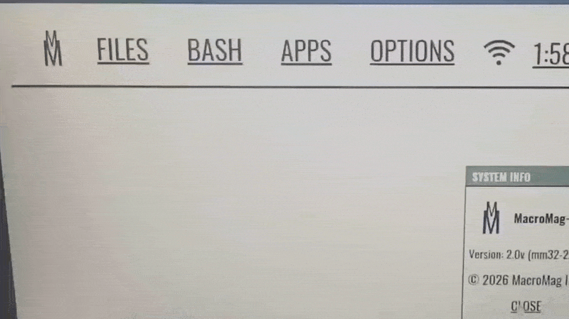

 # MacroMag OS: Modular Linux Distribution New Architecture by Adrian Morawski

<p align="center">
  
</p>


 [](https://doi.org/10.5281/zenodo.24201693)

[](https://www.bestpractices.dev/projects/16688)

[](https://www.gnu.org/licenses/gpl-3.0)
[](#)
[](#)
[](#)
[](https://github.com/MacroMag-os/MacroMag-32/actions/workflows/release.yml)
[](https://github.com/MacroMag-os/MacroMag-32/stargazers)
[](https://github.com/MacroMag-os/MacroMag-32/network/members)
[](https://github.com/MacroMag-os/MacroMag-32/issues)
[](https://github.com/MacroMag-os/MacroMag-32/commits/main)
[](https://opencollective.com/macromag)


> *"Those who are crazy enough to think they can change the world, are the ones who do."* — Steve Jobs

Modern computing is trapped in a cycle of planned obsolescence. Mainstream operating systems and locked-down hardware (*eFUSEs*, remote kill-switches, mandatory cloud telemetry) actively turn perfectly functional electronics into e-waste.

**MacroMag is an experimental Linux Distribution architecture designed for, modularity, and zero-telemetry online execution.** 
   
### Pre-built Prototype (ISO & Binaries)
Don't want to compile from source? Download pre-built prototype images (`MacroMag-x86_64.iso`) and test utilities directly from our **[GitHub Releases](https://github.com/MacroMag-os/MacroMag-32)** page.

## 2. Pure Linux Kernel Core (`x86_64` & `RISC-V`)

Instead of reinventing hardware drivers from scratch, MacroMag leverages a stripped-down, deterministic **Linux Kernel** purely as a hardware abstraction layer.

* **Zero Telemetry, Full Hardware Support:** No background cloud polling, no legacy GNU userland clutter, and immediate compatibility with standard PCs, legacy laptops (Anti E-Waste), and open **RISC-V** boards.
* **VOS Native Execution:** The kernel boots directly into our **Rust/C** runtime and the Virtualized Object Shell (**VOS**), bypassing traditional Bash/POSIX bottlenecks while keeping strict process sandboxing.

### Enterprise Cloud Architecture (Opt-In): While the Community edition operates strictly air-gapped with zero telemetry, MacroMag Enterprise introduces an optional, deterministic cloud control plane. Leveraging VOS typed object pipelines over encrypted channels, organizations can orchestrate fleets of x86_64 and RISC-V nodes, deploy atomic updates ("Online But Always Updating"), and manage hardware modules remotely—available both as a managed cloud service and a self-hosted on-premise solution.

## I want to create a Linux distro, but not a classic one... I want to create something that doesn't exist yet: a free Open version (on which the Enterprise version will also be based), and Enterprise is a paid add-on for Open and my way of making money (but so as not to fall into Red Hat's clutches, this Enterprise system will be cheaper, so I will sell it at a bargain price to smaller IT companies so they buy it). The kernel (Linux) is available, so I don't have to create it, but I want to build such a deep interface that it looks 'not like Linux' and has the style of Apple macOS  but done my way, with my famous logo MM > MacroMag. Now, I know it's damn hard, but complicating a non-existent kernel on my own would be impossible, so I'll use the Linux

# MacroMag OS — Linux Distribution System Creating Context
*Snapshot of architecture, completed milestones, and remaining roadmap for people continuity.*

### Code: Rust/C/C++

## 1. System Architecture Overview
- **Project:** MacroMag OS (`MacroMag-os/MacroMag-32`) — modular, zero-telemetry Linux distribution (`x86_64`) designed for bare-metal PCs, servers, and legacy hardware (anti-e-waste).
- **Boot & Build (`buildiso.sh`):** Statically compiles Rust workspace (`x86_64-unknown-linux-musl`), bundles static BusyBox (`ash`, `fdisk`, `mkfs.ext2`, `tar`, `sha256sum`, `syslogd`, etc.), static `curl` (HTTPS), `fastfetch`, `dropbear` SSH, and `grub-install`, producing a hybrid bootable `MacroMag-x86_64.iso`.
- **Init & Virtualised Object Shell (`userspace/vos`):**
  - Runs directly as `/init` (`PID 1`).
  - Mounts `/dev` (`devtmpfs`), `/dev/pts` (`devpts`), `/proc`, `/sys`, `/tmp`.
  - Reaps orphaned zombie processes (`waitpid(-1, &mut status, WNOHANG)`).
  - Launches `syslogd`, `klogd`, configures DNS (`1.1.1.1`, `8.8.8.8`), and brings up network interfaces via `ip` + `udhcpc`.
  - Dual-mode parser: executes VOS strongly-typed object pipelines (when `(` precedes `|`) and delegates standard POSIX pipes/redirections (`|`, `>`, `<`, `&`) to `/bin/sh -c`.
  - Built-in object modules: `sys.ps()`, `sys.mem()`, `sys.uptime()`, `sys.cpu()`, `sys.install("/dev/sdX")`, `sys.reboot()`, `sys.poweroff()`, `disk.list()`, `net.interfaces()`, `fs.ls()`, `fs.cat()`, `mur.sync()`, `mur.list()`, `mur.install()`.
- **Package Manager (`userspace/mur`):**
  - Connects to `https://github.com` (`packages/*/mur.pkg`).
  - Syncs repository archive (`main.tar.gz`) via `curl` + `tar` (zero `git` dependency).
  - Parses `name`, `version`, `description`, `url`, `bin`, and verifies `sha256` checksums before installing binaries to `/usr/bin`.
  - Commands: `mur sync`, `mur list`, `mur info <pkg>`, `mur install <pkg>`, `mur remove <pkg>`.

## 2. Completed Milestones (Closed Issues)
- **[CORE] `PID 1` Stability:** Implemented zombie process reaping (`waitpid`), `/dev/pts` pseudo-terminal mounting, and `syslogd`/`klogd` background logging.
- **[SHELL] Dual-Mode Pipeline Execution:** Separated VOS typed object pipelines from standard Linux POSIX pipes/redirections.
- **[INSTALLER] Bare-Metal Rootfs Copy (`sys.install`):** Updated `sys_install` to mount boot media (`/dev/sr0`, `/dev/sdb1`) to copy `vmlinuz` and `initramfs.img`, copy `/bin`, `/sbin`, `/usr`, `/etc`, dynamically configure `root=/dev/...` in `grub.cfg`, and unmount cleanly.
- **[MUR] Git-Free Sync & Manifests:** Replaced `git` with `curl` + `tar`, added full `mur.pkg` parsing (`version`, `bin`, `description`, `sha256`), and added `mur info`.
- **[VOS] Hardware Object Modules:** Implemented `disk.list()`, `net.interfaces()`, and `sys.cpu()` in `vos_builtins.rs`.
- **[CI/CD] Automated ISO Build:** Verified passing build workflow (`Build and Release MacroMag ISO`).

## 3. Remaining Open Issues (Next Steps)
1. **`#29` [INIT] Service Supervisor:** Build a Rust `ServiceManager` reading `/etc/vos/services.toml` to supervise and auto-restart background daemons (`udhcpc`, `dropbear`, `syslogd`) + `sys.services()` command.
2. **`#31` [INSTALLER] GPT & UEFI Support:** Detect `/sys/firmware/efi` in `sys.install()` to support GPT + 256MB FAT32 ESP + `grub-install --target=x86_64-efi` alongside Legacy BIOS MBR.
3. **`#32` [CORE] Persistent Root & `/etc/fstab`:** Parse `/etc/fstab` on boot, run `fsck`, and switch/mount persistent disk storage in `rw` mode so changes survive `sys.reboot()`.
4. **`#33` [INSTALLER] Swap & `zram` Support:** Enable compressed `zram` RAM at boot and create `/swapfile` during `sys.install()` for 512 MB–2 GB legacy hardware.
5. **`#34` [SECURITY] Multi-User Login (`userspace/login`):** Integrate password authentication against `/etc/macromag_users` at boot and add `user.add()` / `user.passwd()` built-ins.
6. **`#37` [MUR] Dependency Resolution & Updates:** Support `depends=pkg1,pkg2` in `mur.pkg`, track installed versions in `/var/lib/mur/installed.db`, and implement `mur upgrade`.
7. **`#39` [NETWORK] Wi-Fi & Firewall:** Add `wpa_supplicant` + wireless firmware, `net.wifi()` VOS commands, static IP configuration, and `nftables`/`iptables` rules.
8.**`#40` [SHELL] Line Editing, History & Tab Completion:** Replace raw `stdin().read_line()` with `rustyline` or `termios` raw mode for Up/Down arrow history (`~/.vos_history`) and `Tab` completion.


## 4. Key Repository Files
- `Cargo.toml` — Workspace root (`userspace/vos`, `userspace/mur`)
- `buildiso.sh` — Live/Install ISO builder script
- `userspace/vos/src/main.rs` — `PID 1` init, environment setup, and VOS/POSIX REPL loop
- `userspace/vos/src/vos_builtins.rs` — Built-in VOS modules (`sys`, `fs`, `disk`, `net`, `mur`) and `sys_install()`
- `userspace/vos/src/vos_parser.rs` & `vos_executor.rs` & `vos_core.rs` — Object pipeline lexer, parser, and execution engine
- `userspace/mur/src/main.rs` — MUR package manager CLI
- `userspace/login/` — Authentication module (ready for Issue #34 integration)

## 5. Our goal is Build Real Linux Based System powerful Like Ubuntu Text Version
- `no qemu or emulators only real 64-bit Architecture`
- `vos and mur connect in to Macromag-os Linux System`
- `in future we thinking about GUI and enterprise function add`


## ⚡ Core Architectural Pillars

### 1. The Virtualized Object Shell (VOS)
MacroMag replaces traditional raw-text shells with an object-oriented execution environment.
* **Typed Memory Pipelines:** Commands exchange strongly-typed objects directly in memory rather than parsing fragile text streams (`grep`/`awk`/`sed` hacks).
* **Native Sandbox Syntax:** Process isolation is built directly into the shell syntax. Every untrusted execution runs inside a lightweight microkernel sandbox by default.

### 2. Graphic iNTERFACE
* **Zero Telemetry, 100% Determinism:** No background cloud polling, no hidden corporate firmware. CPU cycles go strictly into user-defined tasks.
* **Open Architecture First:** Rather than reinventing proprietary silicon, MacroMag targets open **64-bit RISC-V** hardware and FPGA implementations, leveraging existing modern toolchains (Rust/C/LLVM).
* **Self-Contained Core:** Designed to operate completely air-gapped with a lean, auditable set of essential system tools.

### 3. Long-Term R&D: Magnetic Modularity & Phantom BIOS
Our long-term hardware vision aims to eliminate single-point-of-failure motherboards and fight e-waste:
* **Decentralized Phantom BIOS:** Each physical hardware module carries its own minimal firmware descriptor, registering its capabilities dynamically upon connection.
* **Hot-Swappable Hardware Nodes:** Researching fault-tolerant, magnetic/pogo-pin interconnects for deterministic real-time module replacement without system crashes.

### 4. MUR (MacroMag User Repository) 
Inspired Arch User Repository, Tools build in system connecting with VOS simple commands, connected with system. 
visit Repository: **https://github.com/MacroMag-os/mur**

### 5. MacroMag As New Linux Distribution
We want to be the most powerful But simple linux Distribution with good GUI and a lot of Functional useful system data

## 🤝 Project Leadership & Team

* **Adrian Morawski (@adrianmorawski713)** — **Founder & CEO** (Project Creator, Lead Architet & Vision)
* **Alan Morawski (@sxalanek)** — **Core Administrator** (Code, Legal Compliance & Security)
* **Maldyrek (@maldyrek)** — **Core Administrator** (Operations & Community Management)

## 💜 Support
**We Need Your Support To: - Create Official Website (macromag.org) of project and paid for code evolution progress mode!**
# if you want give us a donate, Go To opencollective Site **[Support](https://opencollective.com/macromag).** Page

---

## 💻 Paradigm Shift: VOS Syntax Concept

**Traditional CLI (Raw String Parsing):**
```bash
vm-list | grep "RUNNING" | awk '{if (\$3 > 512) print \$1}'
```

**MacroMag VOS (Typed Object Pipeline):**
```powershell
vm.list() | filter status == "running" && memory > 512MB | select name
```

**Sandboxed Execution:**
```powershell
spawn --isolated --image:web_server -> Core.VM
```

---

## 🛠️ Current Status & Roadmap

We are currently in the **Minimalist Value Product (MVP — Bare-Metal x86_64)** phase. Honest engineering comes first:

- [x] **Phase 1: Architectural Concept & Python Prototype** (`powershell32.py`, basic assembler & simulation scripts).
- [X] **Phase 2: Create MUR (MacroMag User Repository)** — Write The Arch inspired user Repository with tools build in system MacroMag **Rust / C** for deterministic performance.
- [X] **Phase 3: Minimalist Value Product** — Linux Based system graphic with new "linux-os" for all and enterprise model
- [ ] **Phase 4: Get full working system** — With MUR connect, working commands, VOS. 
- [ ] **Phase 5: Get working GUI added to system** - Graphical interface and most powerful tools with VOS
---

## 🤝 How to Contribute

MacroMag is an ambitious, founder-led open-source project initiated by Adrian Morawski (2026). We are looking for curious engineers, systems programmers, and hardware tinkerers who want to build something unconventional from the ground up.

## 🟡 Rule of MacroMag ™
Online But Always Updating, We giving two versions of MacroMag OS: Free for people, paid for enterprises. 

## ⚠️ Transparency & Security Notice (About `.exe` Files)

If you notice pre-compiled `.exe` binaries in this repository or in our Releases, please note that **they are legitimate, open-source system utilities and prototypes** built for the upcoming **MacroMag-32** ecosystem (for testing and emulation purposes).

* **100% Open Source:** Every binary comes directly from the source code available in this repository (licensed under **GNU GPL v3.0**). You do not have to trust our pre-built files—you can inspect the code and compile everything yourself from scratch.
* **Zero Telemetry & Safe:** In accordance with the MacroMag Foundation core principles, none of our tools contain telemetry, tracking, or obfuscated scripts.
* **Why `.exe`?** While our target architecture is a bare-metal RISC-V microkernel, early userspace apps, tools, and simulators are temporarily compiled for Windows to allow rapid testing and development.

If you have any questions about a specific file or want to verify a build, feel free to open an Issue or check the source directories!


We especially welcome help with:
1. **Linux Distribution Creators:**
2. **Linux Based system Architecture:**
3. **Rust & C Engineers:**

Check the **Issues** tab to see current tasks, or open a Discussion to share architectural feedback.

---

## 💼 Licensing & Vision

MacroMag is licensed under **GPL v3** to ensure the core architecture remains free and open forever. Our long-term goal is to develop open-source developer kits and modular hardware appliances for industrial automation, education, and air-gapped security environments. Adrian Morawski Is Official Project Leader (like CEO) 

*Initiated by Adrian Morawski (2026)*
